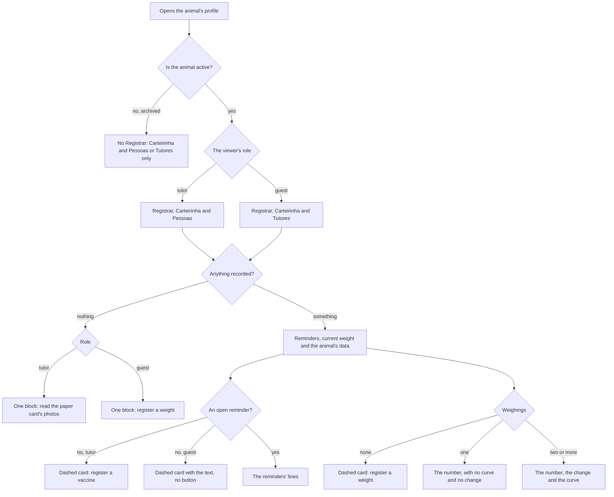

# The animal's profile

What the profile shows, by the viewer's role and by what the animal has
recorded. Every empty part leads to what fills it, for whoever can use it. The
history is not here: it lives in the card (`docs/agents/domain.md`,
Carteirinha). Registrar, Carteirinha and Pessoas or Tutores sit under the
header in every branch below.

Registrar opens a sheet: for a tutor, reading the paper card's photos first and
the five kinds by hand below; for a guest, weight and note.
