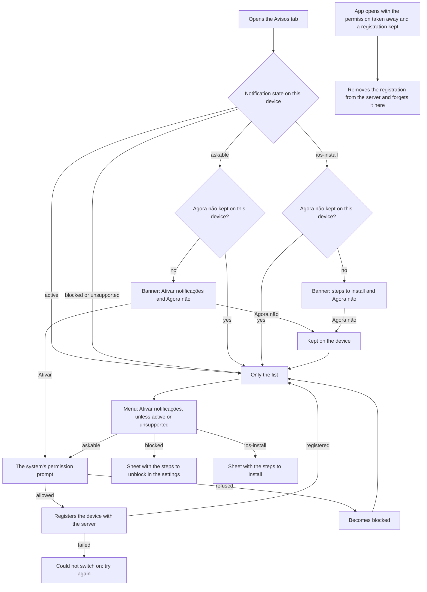

# The notification on one device, in the Avisos tab

What the web app (`web/src/components/DevicePush.tsx`) and the native app
decide on their own about the notification of the device they run on. The
states and the banner rule are shared (`packages/core/src/domain/push.ts`);
each app works out its own state. What the server sends is drawn in
[`notice.md`](./notice.md).

