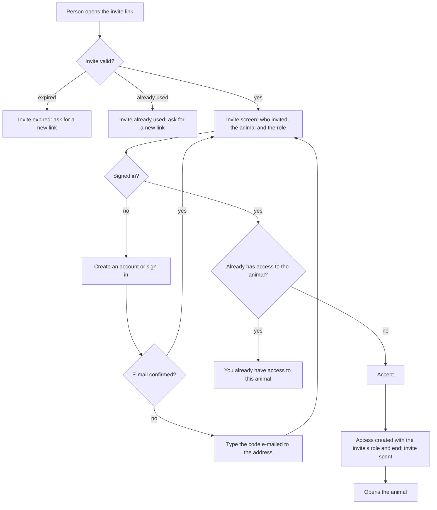

# Accepting an invite

Someone opens an invite link (ADR-0006). The link is single-use and valid for
3 days; it carries the role and, for a guest, the access's last day. It is sent
to no address, so it does not confirm anyone's e-mail (ADR-0002): a new
account types its e-mailed code before it can accept.

