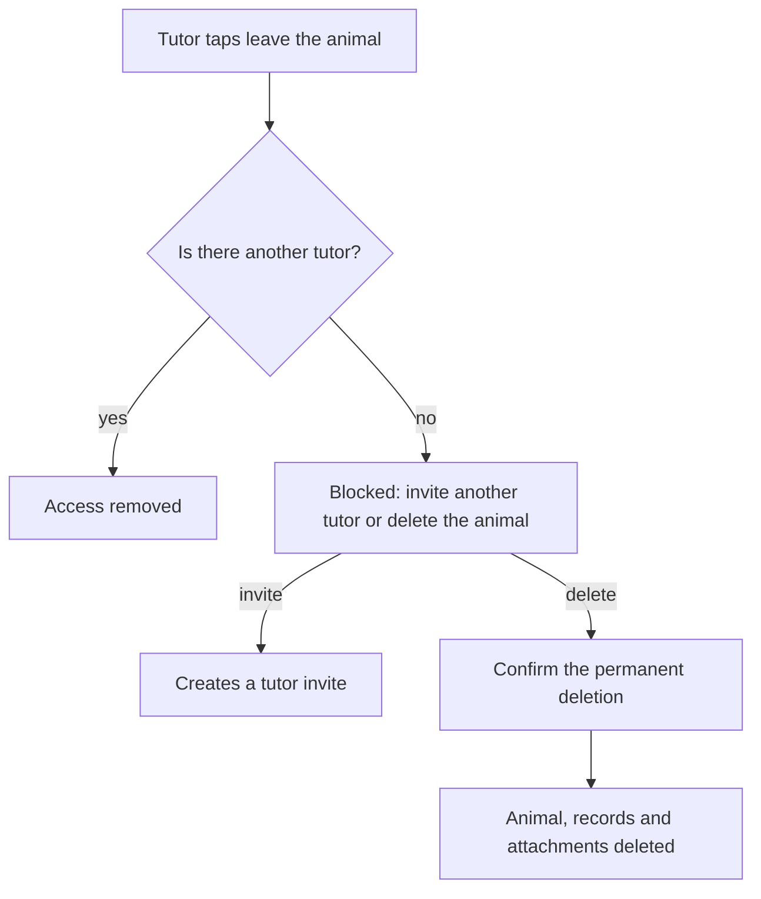

# A tutor leaves an animal

Every active animal keeps at least one tutor (ADR-0006). The backend refuses
the last tutor's leaving, and removing the last tutor in any other way, with
`409 last_tutor`.

