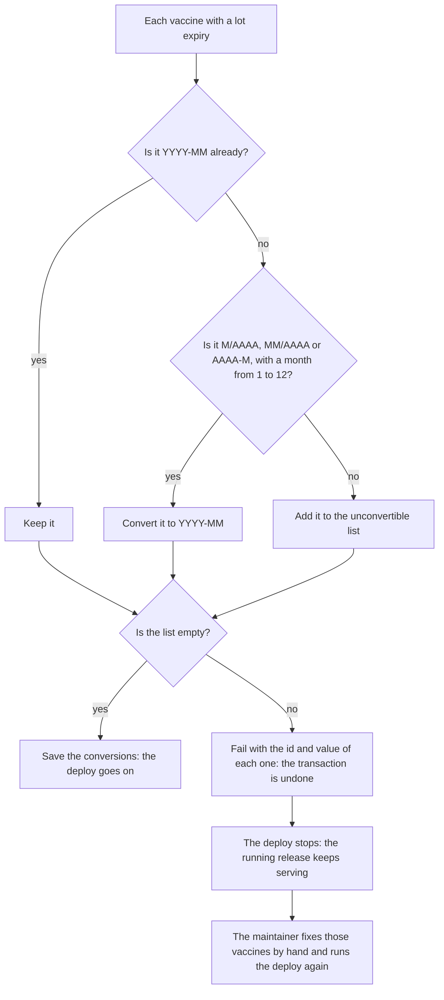

# The lot expiry migration

What `animals/0002_lot_expiry_is_a_month` does to the vaccines already stored
(ADR-0010). It runs inside one transaction, in the one-off `migrate` container
that `deploy.sh` starts before it swaps the release.

