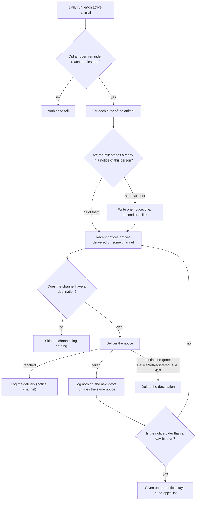

# The daily notice run

What `send_reminders` does once a day (`reminders/dispatch.py`, ADR-0004 and
ADR-0009). A notice is written once per person, animal and day with its words
frozen; each channel then only delivers it. The words come from
`reminders/wording.py`.

