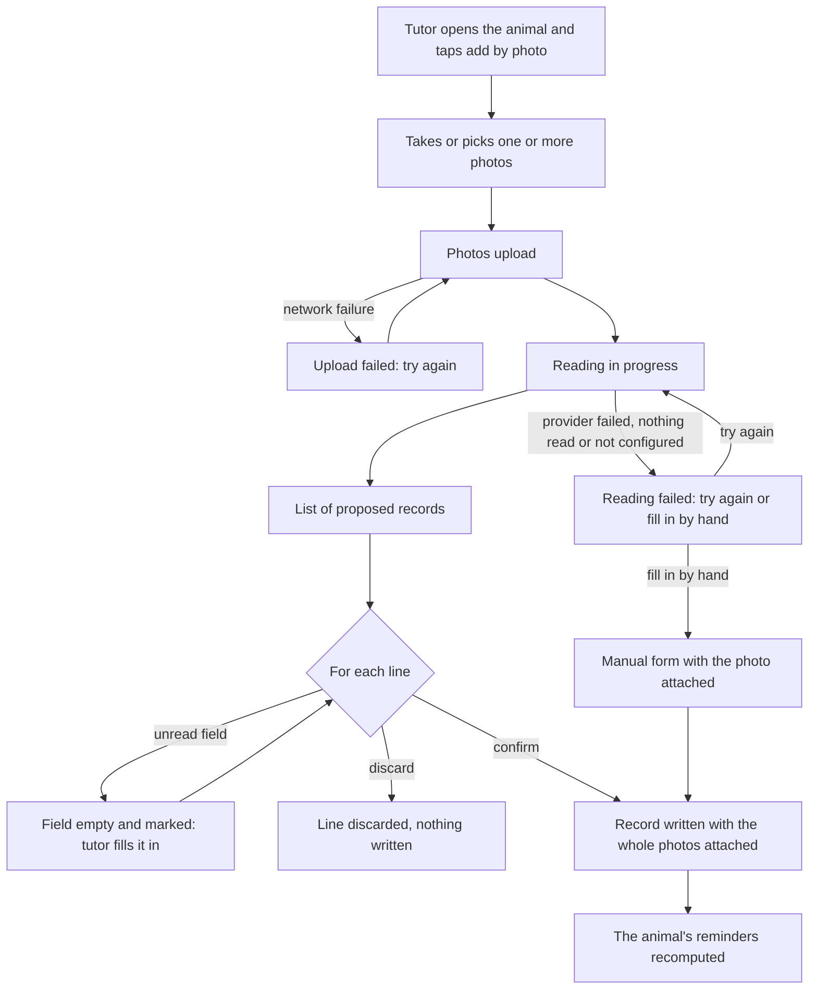

# Photo intake

A tutor loads a card page into an animal's history by photo. The model only
proposes; nothing is written until the tutor confirms a line (ADR-0005). The
reading runs outside the request, in the worker, and the client follows its
state.

