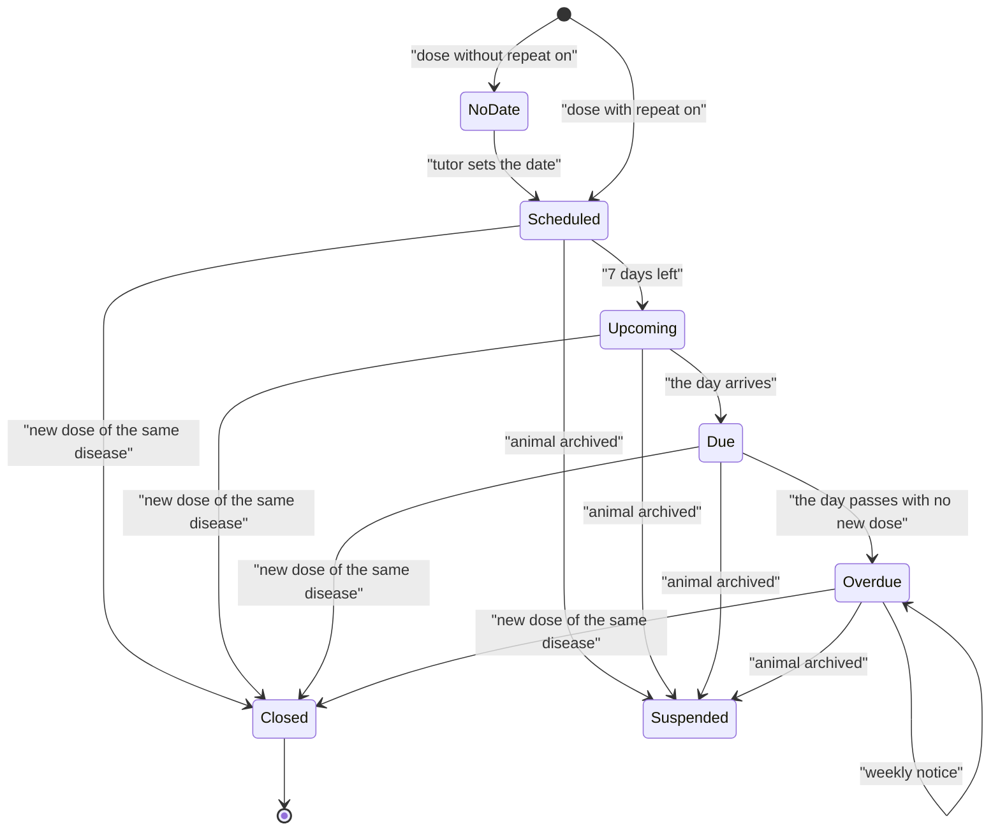

# The reminder of one disease of one animal

The life of the reminder for one subject (a disease, or an antiparasitic kind)
of one animal (ADR-0003). It is derived from the doses, never typed; the daily
job sends a notice at each milestone (ADR-0004): seven days before (entering
`Upcoming`), on the day (`Due`), and every seven days while `Overdue`.

