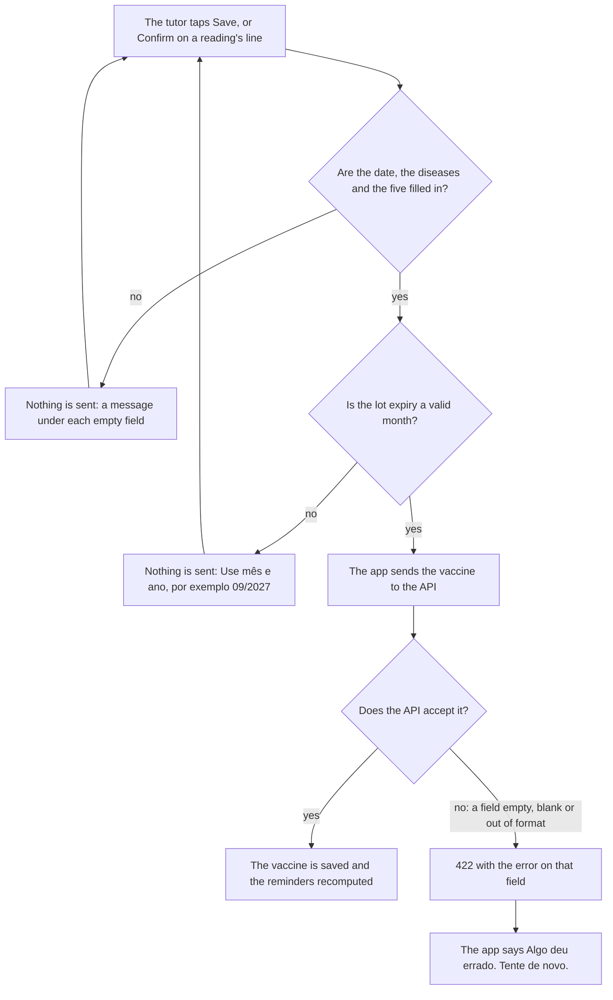

# Saving a vaccine

What happens when a tutor saves a vaccine, by hand or by confirming a line of a
reading, in the web or the native app (ADR-0011). The five fields of the label
and the stamp are brand, lot, lot expiry, vet and CRMV.

The apps check the same rules as the API, so the 422 is met only by a client
that does not, or by an app older than ADR-0011.
